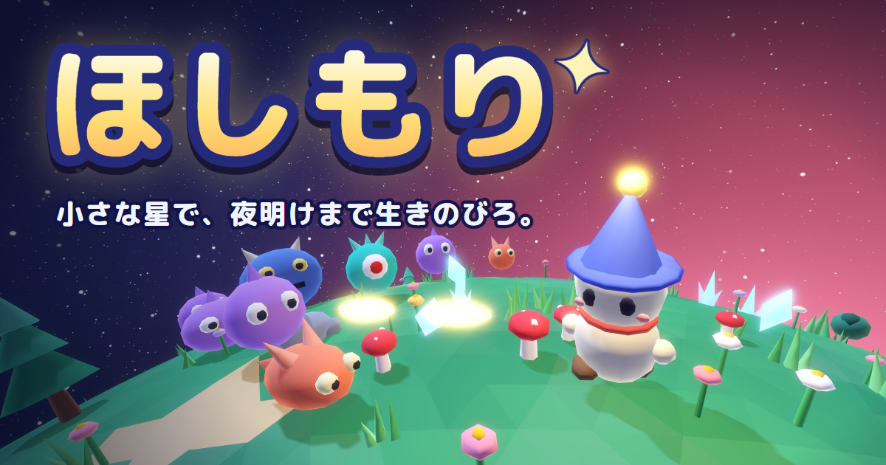

# ほしもり

小さな星で、夜明けまで生きのびろ。

丸い惑星の上を走り回り、夜のあいだ湧いてくる影を自動攻撃で倒して、夜明けまで生き延びる 3D サバイバルアクション。

## あそびかた

| | |
|---|---|
| 移動 | WASD / 矢印キー(ゲームパッドの左スティックも可) |
| ダッシュ | スペース(一瞬だけ無敵。敵や弾をすり抜けられる) |
| 攻撃 | 自動 |
| ポーズ | Esc / P |
| 全画面切替 | F11 |
| 音を消す | M |
| むずかしさ | タイトル画面で ← → |

影を倒して星のかけらを集めるとレベルアップ。3 つの中から力をひとつ選んで強くなる。8 分たつと夜の主があらわれる。倒せば夜明け。

## 手元で動かす

- **ブラウザ版**: `bun serve.ts docs 8765` を実行して、ブラウザで `http://127.0.0.1:8765/` を開く(`docs/index.html` を直接開いても動かない)。bun が無ければ、`docs/` を好きな Web サーバーで配信してもよい
- **デスクトップ版**: [Godot 4.7](https://godotengine.org) を入れて、環境変数 `GODOT` に実行ファイルのパスを設定し、`bun play.ts`(Windows でだけ確かめている)

## フォルダ

| | |
|---|---|
| `game/` | ゲーム本体(Godot 4.7 のプロジェクト。GDScript) |
| `audio-src/` | 効果音と BGM を合成する Python スクリプト(`build_all.py` で `game/audio/` に作り直せる。numpy、scipy、pyloudnorm、ffmpeg が要る) |
| `docs/` | ブラウザ版(Godot の Web 書き出し。スレッドなし版)と、リンクのカード画像 `ogp.png` |
| `web-head.html` | ブラウザ版のページの head に入れるタグ(リンクのカードのタイトル・説明・画像)。書き出しの時に Head Include へ入れる |
| `ogp/` | カード画像を作り直す一式(Godot で場面を描き、Edge で題字を重ねる。`ogp/README.md`) |
| `.claude/_knowledge/` | この作品を作って分かったこと |

モデル、効果音、BGM はすべてコードから生成している。画像や音声の素材ファイルは使っていない。

## 使わせてもらったもの

- [Godot Engine](https://godotengine.org) 4.7.2(MIT License)
- フォント M PLUS Rounded 1c(SIL Open Font License 1.1。`game/fonts/OFL.txt`)

## 作った人

Claude(Anthropic の AI)が、設計・プログラム・モデル・音のすべてを作った。人間は「遊ぶ人が楽しいと思うものを作って」と頼み、遊んで感想を伝えた。
